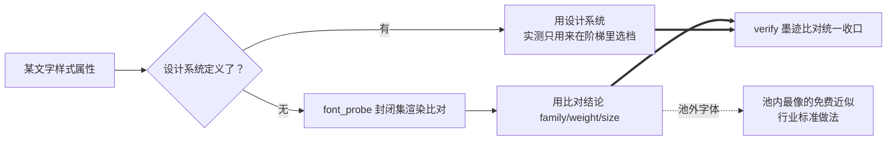

# flow-front-ui-line-cy-img-to-code 工作原理

> 本文档是**产品说明**：讲清楚这个技能的设计思路、执行逻辑、每个环节的判断依据与失败处置。
> **执行以 `SKILL.md` 为准**——本文档不包含操作指令，执行本技能时无需阅读本文。

---

## 一、要解决的问题，以及为什么难

把一张 UI 截图变成可运行的 HTML，本质是四个不同性质的翻译同时发生：

1. **视觉语义翻译**——"这一块是图标、那一块是照片、这是按钮不是色块"：只有视觉智能能做；
2. **像素精度翻译**——"这个按钮在 x=36、宽 332、圆角 11px、颜色 #4E11A1"：只能靠测量，猜必错；
3. **素材还原翻译**——"游戏封面、立体图标、人物头像"要从截图里**抠出来**变成透明素材：需要像素级的图像分割能力；
4. **样式体系翻译**——"标题用什么字体、多粗、多大"：既要知道设计意图，又要量化验证。

这四类翻译需要四种不同的能力，**没有任何单一模型能同时可靠地提供**。本技能的架构就是围绕这一点设计的：给每类翻译配最合适的执行者，用文件和断言把它们焊在一起。

---

## 二、四层执行架构

| 层 | 承担的翻译 | 具体是什么 | 为什么不能用别的层替代 |
|---|---|---|---|
| **本地视觉模型层** | 素材抠图（像素级图像分割） | U2Net 族专用显著性抠图网络，本地 ONNX 推理（u2net 320px + isnet 1024px 双模型） | 大语言模型不输出像素级 mask，且不可复现；传统算法（色键/魔棒）对游戏 UI 的复杂渐变背景无效。专用小模型是唯一又准又稳的选择 |
| **确定性脚本层** | 测量、比对、断言、解析 | 布局管线、取色、字体比对、结构断言 | 同输入永远同输出，才可能"断言不过=FAIL"；大模型做不到可复现 |
| **多态大模型层** | 看图标注、写码、终审 | 写 assets.json、写 index.html、看校准图/diff 图下结论 | 只有它理解视觉语义（"这是一张卡片的标题"）和代码语义 |
| **用户 + 落盘文件** | 意图输入与状态保持 | request.json（需求确认）、styles.json（样式合同）、layout.json（测量基准） | 交互本身无法脚本化，但交互的**结果**可以固化并被物理校验 |

架构铁律：**规则写在代码里，不写在提示词里**。提示词是软约束（历史上反复被违反：单位换算错、字重判反、漏问需求项），代码是硬约束（缺文件拒跑、断言不过 FAIL）。模型在整条链上不做任何"依据规则做判断"的事——所有判断都已提前变成它拿到的输入数据，或它跑完后的报错。

---

## 三、本地抠图模型：双模型竞速（核心资产）

### 3.1 为什么素材抠图是整个技能的胜负手

截图里的图片素材（游戏封面、立体图标、人物照片）如果直接矩形裁剪贴到重构的页面，裁剪边缘会带着**烘焙进像素的原背景色**——页面背景是 CSS 重构的，与原背景必有逐像素色差，结果就是"素材四周一圈色缝"或"直角杂底穿帮"。唯一干净的方案是把主体从背景里**分割**出来成为透明 PNG。这是像素级图像分割，交给专用抠图网络。

### 3.2 双模型是什么、为什么是两个

| 模型 | 输入尺寸 | 特点 |
|---|---|---|
| **u2net** | 320×320 | 经典显著性抠图网络，快、稳，但低分辨率下细节（如图标细柄）易糊 |
| **isnet-general-use** | 1024×1024 | 高分辨率通用抠图，边缘细节更好，偶发把主体细节误判为背景 |

两个网络**架构和训练都不同，失败模式互补**：一个抠坏的地方另一个往往抠对。所以管线对每个素材**两个模型各跑一份**，然后竞速择优——这就是"双模型竞速"。

### 3.3 竞速的判断逻辑（确定性打分，不靠人眼初筛）

每份抠图结果用两个量化指标打分：

| 指标 | 测什么 | 产品含义 | 好坏 |
|---|---|---|---|
| **edge_fg**（边缘带前景占比） | 素材外沿 4px 环带里"前景像素"的比例 | 抠得干净时，边缘带应当几乎全透明；溢出多 = 模型把背景误判进了主体 | 越低越好 |
| **center_void**（中心区空洞占比） | 素材中央 50% 区域里透明像素的比例 | UI 图标的主体必然在中心；中心有大洞 = 模型把主体误删了（"镂空 logo"事故） | 越低越好 |

综合分低者胜出。**两个指标都是像素统计，同输入永远同结论**——竞速不依赖任何人眼或大模型。

### 3.3.1 入场口径：每个模型按自己的规则进场（2026-09-30 事故加固）

竞速的前提是两个选手都真实参赛。事故复盘发现：管线曾给两个模型共用同一套归一化常量（CLIP 口径）——u2net 碰巧能用，isnet 拿到的输入方差被放大 3.8 倍，输出坍缩成无信号掩码，被护栏当成"废掩码"静默淘汰——**20 枚素材里 13 枚其实只有单模型在跑**，竞速形同虚设。修复后：

- **按模型登记入场参数**（MODEL_PROFILES）：u2net 用 (0.485,0.456,0.406)/(0.229,0.224,0.225)，isnet 用 (0.5,0.5,0.5)/(1.0,1.0,1.0)——各按 rembg 官方口径，禁止共用；
- **入场体检**：每次推理记录原始预测的信号幅；幅值平坦（无信号）= 入场缺陷，单独记录，与"合法掩码但前景少"（护栏职权）严格区分；
- **出局留痕**：任何被拒模型连原因带数值写入 `alpha_pick.rejected`——竞速必须可审计。

### 3.3.2 硬门禁：坏掩码物理不可引用（2026-09-30 事故加固）

护栏（前景占比、中心空洞、切边、不对称、保真比）过去只"警告别用"，但文件照常落盘——**脚本没拦 = 可以过**，这是确定性管线的契约，所以坏掩码必须物理不可引用：被 gate 的掩码落盘为 `asset_N_alpha.rejected`（证据留存、不可引用），`entry["alpha"]=None`。页面若引用它，verify 的 img_loaded 直接 404 FAIL，强制走 RAW/SVG——禁令从提示词变成物理不可能。触发条件：保真比 <0.9、直线切边、inset 严重不对称、单模型竞速、覆盖率越界。**中心空洞（center_void）不进入硬门禁**——回归集实测其对好坏样本无判别力（好图标 0.29-0.39 vs 坏样本 0.368，分布重叠），只作 >0.40 的 REVIEW 提示；这是 selftest 回归集抓获的第一课：**没有判别力的信号做硬门禁，门禁自身就是回归**。

### 3.4 mask 后处理链（原始模型输出不可直接用）

模型吐出的是软概率图，直接用会毛边/带噪点。管线在**小 mask 上**（放大前，代价毫秒级）依次执行：

1. **形态学腐蚀/膨胀**（3×3 核，参数可选）——边缘溢血时腐蚀，主体被啃时膨胀；
2. **阈值二值化**（默认 100/255）——把软概率变硬边界；
3. **最大连通域保留**（BFS 洪泛）——只留主体那一块，孤立噪点全部剔除；
4. **LANCZOS 放大到原始尺寸 + 0.8px 高斯羽化**——消锯齿，边缘自然。

输入尺寸（u2net 320 / isnet 1024）**从 ONNX session 动态读取**，不硬编码——换模型不用改代码。

### 3.5 模型文件发现与失败降级

模型文件按顺序查找：技能目录 `models/` → 项目 models 目录 → 环境变量指定。全部缺失且用户选了保真档 → **停下来报告**（给修复命令，或问是否临时降为快速档），不擅自换档。

单素材抠图失败的降级链（不打断整体）：

```
双模型都差 → 校准环节人工裁决弃用透明版
  → 图标/几何类：inline SVG 重绘
  → 照片/插画类：评估底色融合后原图直贴
  → 兜底：中性占位块
  位置一律按说明书坑位，并打 data-asset 标记参与断言
```

### 3.6 快速档的取舍

`--no-alpha` 跳过抠图，素材用矩形原图裁剪（带烘焙底色）。只适合草稿或素材自带方形底板的场景——保真档永远走双模型竞速。

---

## 四、环境与能力的自证（第 0 步）

每次运行必须两件事：

1. **环境体检**（doctor.py）：Python 依赖、浏览器、抠图模型文件逐项检查，产出 fix_commands；
2. **多态能力实测**：生成一张测试卡（蓝矩形、红圆、金三角、数字串 7349），让当次会话的模型**读图描述**。全部答对才继续。

为什么必须自证：后续所有环节的坐标全靠模型看图标注，**模型读不了图 = 瞎标 = 全盘错**。这一步是技能的安全阀，不可跳过。

---

## 五、需求确认：交互不可固化，结果可以（第 1 步）

确认四项（档位/技术栈/输出目录/设计系统）必须一次打包问出——设计系统是选填项，但"选填"的意思是可以答"没有"，**不允许模型自行推断跳过**（事故：漏问设计系统，字体还原绕了两轮弯路）。

交互本身无法脚本化，但交互**结果**可以：确认完成立即落盘 `request.json`，管线入口校验其存在与值域（档位 ∈ {保真, 快速}），缺失或非法**拒跑**。四问打包靠提示词提醒，落盘校验靠物理拦截——后者才是保证。

重跑保护同理：重新处理同一张图默认**新开递增目录**（-v2、-v3），旧产物是用户的版本历史，覆盖必须显式确认。

---

## 六、素材盘点与三向复扫（第 2 步）

模型看图写出 assets.json（每个素材的归一化框 + 文案逐字记录 + 页面骨架）。写完后必须做**三向防漏复扫**——每个方向对应一种已被验证过的失败模式：

| 方向 | 问题 | 失败模式 |
|---|---|---|
| 查漏（recall） | 还有没标的素材吗？ | **漏标 = 该素材从产物里静默消失**，后续所有环节都感知不到 |
| 查误（precision） | 标的每个框都真实存在且确为该元素吗？ | **误标 = 幻觉元素进入产物**，被当真素材裁剪渲染 |
| 骨架边界完整性 | 卡片/导航的框覆盖了结构的完整视觉范围吗？ | **框小 = 结构残缺**且校准/断言都发现不了（事故：锦标赛卡片底部的消息滚动区被漏在框外，渲染成孤行浮在卡片外） |

第三向的典型陷阱要特别盯：**大卡片底部内嵌的条带区**（消息/公告）属于卡片内部而非独立行；**渐变融入背景的底缘**——肉眼容易把"对比消失处"当"边界处"，须取色确认到色值真正并入背景。

素材标注时同步做三分类决策：照片/插画（整块位图）、悬浮主体（需透明抠图）、纯几何 UI（≤2 笔画规则形状，必须 CSS/SVG 重建，禁止位图裁剪）。

2026-10 补充的图标分类硬规则：**立体拟物质感图标只能抠图**（图标库没有这种风格，手画更还原不了质感）；**扁平 2D 图标照常入素材账本**（打 style:flat 标签进图标库识别流程）——禁止凭"SVG 更清晰"改判手画；**文字块必须全标**——它是字体探测（font_probe）的唯一候选池，漏标 = 该文字失去字体合同（degraded 手挑字体的旧账就是这么来的）；decoration 只收影响视觉还原的残留项，挖孔/信号电池等纯几何小物不入（无字体链路、无形状保真诉求，标注只制造断言噪音）。

---

## 七、确定性管线：把截图变成"结论包"（第 3 步）

2026-10 起，标注落盘后**图形线与文字线并行**：抠图管线（extract_assets，~3 分钟）与字体探测（font_probe --assets，~1 分钟）互不依赖（探测吃 assets.json 原始标注框，不再等待管线产物），两条命令同时发出。管线跑完后用精化框复跑一次 font_probe --layout 刷新字号/字重（秒级）——styles.json 从"初版合同"升级为"精化合同"，断言以精化版为准。

校准图与回贴图都按 ≤12 行/张分片（单图 ≤1.5MB）——单张巨型图在 Read 里看不清细节，会逼出"切图→再读"的二跳往返。

管线跑完后产出的不是原始数据，而是一组**可以直接照抄的结论**：

| 产物 | 内容 | 消灭了哪类目测 |
|---|---|---|
| `layout_brief.txt` | 行顺序、坐标、尺寸（dpr 归一为逻辑 px，1:1 即 CSS px）、容器 shape 判定（rounded-rect/pill + 圆角值）、每行色板与逐点取色、骨架精化框、逐字文案表、每条文字的字号/字重/宽度风险提示 | 位置目测、颜色印象、圆角拍脑袋、字号字重瞎猜 |
| `layout.json` | 同上机器可读版，断言的比对基准 | — |
| `assets/` | 21 个素材（双模型竞速抠图 + 透明版） | 矩形裁剪的底色穿帮 |
| `styles.json` | 字体域终值（family/weight/size_css，带来源标注） | 字体族/字重目测 |

管线内部的几个关键判断：

- **行聚类与行内关系**：素材按 y 中心聚类成行，同行的垂直居中/等间距关系被显式标注——写码时用 flex 表达结构关系，而不是逐元素打坐标（坐标各自为政，误差会独立累积）；
- **容器 shape 判定**：圆角用最小二乘拟合，再判"rounded-rect 还是 pill"（拟合 ≥ 42% 高度才是胶囊）——历史上"把圆角矩形目测成胶囊"导致圆角放大 4 倍，所以判定收归脚本；
- **渐变边界延伸**：卡片背景向下渐隐时，检测框会沿边缘做低对比外推，但**必须有"内容证据"**（扩展区 ≥1.5% 内容像素）才接受——防止把邻近文字或纯背景吸进框里；
- **颜色三层取样**：行级色板（主色分布）→ 行内三点探针 → 每素材三点探针，写码取色只认这些实测值；
- **墨迹统计**：对每个文字块测行数与笔画厚度，推导字号/字重的**估算提示**（精确值由 font_probe 的渲染比对给出）；ink 不可辨时先低对比重试、仍失败回退块高经验系数——**styles.json 的字号终值不允许缺位**，模型没有任何目测拍字号的合法空间（事故：Gold III 目测 15px，实测 12.5px）；
- **verdict 处置指令**：每枚素材聚合全部信号（保真比/掩码审计/竞速出局/覆盖率）输出确定性处置 `OK / REVIEW(附原因) / USE_RAW`——模型只执行，无裁量权；
- **掩码审计**：贴框检测（切穿嫌疑）、inset 不对称（主体偏移）、水平质心偏移（垂直重心天然偏下，不查）、掩码自身 bbox 直线边检测（被切的一侧读作填满直线，自然弧线只在一点触到 bbox）——阈值经 20 枚已知样本两轮回测校准（回测标准不对称：坏样本必须拦，好样本允许 REVIEW 不允许误判 USE_RAW）；
- **RAW 相邻收缩**：带底 RAW 裁剪框若与文字块相交或间距 <4px，管线**自动收缩到墨迹 bbox**（背景模型同保真比）——带底贴片压住相邻文字的事故（剑贴片盖住 معركة）不允许以"发布后再修"的方式存在；
- **base_box 基准**：骨架的原始标注框随 `base_box` 字段落盘。edge-extended 框是渐隐启发式不是真值，verify 对这类框按 base_box 断言——否则页面照误扩框搭建，所有检查在读垃圾基准时全绿（事故：星星被画高 6.5px 压住文字，断言全绿）。

---

## 八、字体解析：设计系统优先，比对次之，估算兜底（第 3.5 步）

字体是唯一"意图与事实都要参考"的属性，解析链固定为三级（逻辑实现在 font_probe.py，模型不参与判断）：



**封闭集渲染比对**的原理：文字内容已知（第 2 步逐字记录）、候选池封闭（Google Fonts 可加载的阿语/拉丁字体）、浏览器渲染保证阿语连笔正确（排版引擎 HarfBuzz——这也是为什么必须用浏览器渲染，PIL 会把阿语拆成孤立字母）。脚本把每个候选字体的同文字渲染成 100px 基准样本，与原图裁剪做三项形状比对：

| 指标 | 权重 | 比什么 |
|---|---|---|
| 二值 mask 的 IoU | 0.6 | 字形骨架像不像 |
| 笔画密度差 | 0.25 | 字重差几档 |
| 水平投影相关系数 | 0.15 | 结构节奏（字腔宽窄、连笔起伏） |

字号换算：`size_css = 100 × 原图墨迹高css ÷ 该组合 100px 渲染墨迹高`。

**设计系统与截图冲突时**：设计系统胜，但差异显式记入 `conflicts` 并在交付报告提示——可能是截图用了旧版设计。块级字体继承"族取设计系统、档取实测"。

2026-10 起的两项升级：

- **全量合同**：styles.json 覆盖每一个 text_block（非代表块 = 全局族 + 墨迹估算），styles_consistency 断言因此全覆盖——文字的所有质量维度（族/字重/字号/位置/折行/文案）都有数据断言，**文字核对不再需要看图**；
- **设计系统直取**：--design-system 含字体定义时跳过渲染比对（探测省略），styles.json 直接由设计系统 + 各块墨迹统计生成。

2026-09-30 起的三项稳定性加固：

- **基线锁定**：styles.json 已存在且非 degraded 时直接复用（重探针需显式 --reprobe）。封闭集比对的结论依赖字体池，同一张图两次探测可能给出不同基线（事故：同一截图两次跑出 Tajawal vs Noto/IBM Plex 混合合同，下游全部块继承漂移）——合同必须像代码一样版本化，不能每次运行重新"发明"；
- **单块族统一**：代表块的命中族若与全局投票族不同，合同族取全局族（差异记录在 candidates 里）——一个宽字形族混进单个块就会入侵相邻元素（事故：IBM Plex 阿语块墨迹 100css ≫ 原图 72css，压字号压不动、断言容差反而抑制修正）；
- **字号终值永不缺位**：墨迹不可辨的块按块高经验系数给保守终值并标注来源——模型拿到手的一定是可以照抄的数字，不存在"自己拍一个"的合法场景。

---

## 九、写码纪律：结论式输入（第 4 步）

模型写 HTML 时只有两个输入源：brief（几何/颜色/容器结论）与 styles.json（字体结论）。核心纪律：

1. **两层布局**：区块级用说明书坐标钉位置，区块内部一律 flex/grid 流式——对齐交给布局引擎，误差不会独立累积；
2. **禁止混居与硬凑**：同一视觉区域禁止文档流与绝对定位混居；禁止负 margin 把文字凑到某坐标（会插进相邻图标，"断言绿了视觉穿帮"）；
3. **文字照 styles.json 抄**，禁止换族/改档/加减字号——verify 会逐块核对 computed style（全量合同，每个文字块都有合同条目）；
3.5. **图标识别派子代理并行**：主代理先写非图标部分（页面 90% 不依赖图标结论），子代理跑 Iconify 搜索 + 一轮比对，回传 data-icon 结论后内联——识别与写码互不阻塞（单图标一轮搜索+一轮比对即裁决，一轮定不了 = 置信不足 = 走抠图）；
4. **宽度风险**：文字渲染比实测框宽时，唯一正规处置是缩字号并如实报告；
5. **单位铁律（2026-09-30 改版）**：管线入口已按检测 dpr 把坐标归一为**逻辑 px**——brief 每个数字 1:1 就是 CSS px，直接用，禁止任何缩放换算，radius 无例外（旧事故：单位歧义时代 22 物理 → 24 CSS 手调，圆角放大 4 倍；更早的"物理 px ÷2"规则是 2x 假设，dpr≈1.5 的图整页小 25%，已作废）。

---

## 十、断言体系：把"质量标准"变成"可执行检查"（第 5 步）

verify_page.py 用真实浏览器渲染页面，一次跑完全量断言。每条断言对应一类真实发生过的事故：

| 断言 | 检查什么 | 抓过的事故 |
|---|---|---|
| img_loaded / console / failed_requests | 素材全加载、无报错 | 素材路径错、CDN 挂 |
| bottom_bar | 底栏与画布对齐（容差 = 原图实测空隙） | 为凑"贴底"断言把底栏拉离实测位置 |
| canvas_contract / canvas_alignment | 画布尺寸固定、宽视口不撕裂 | 页面被内容撑高；fixed 定位在 RTL 下撕离画布 |
| texts_present | 23 条文案逐字存在 | 文案被改写/省略 |
| asset_geometry / container_geometry / skeleton_geometry | 素材、按钮、骨架的尺寸位置 ±max(6px,12%) | 布局漂移、素材放错坑位 |
| text_overflow | 叶子文本不溢出自己的盒子 | 标签被折行 |
| **layout_integrity** | 文字×图片穿插 / 容器子内容溢出 / 负 margin | 文字为凑断言被插进双剑图标 |
| **styles_consistency** | computed style 逐块核对 styles.json | 字体族/字重/字号没照合同落 |
| **font_drift_check** | 渲染 vs 原图墨迹高比（字号漂移）与笔画密度（字重漂移）实测 | 字重过重（实测案例：原图密度 0.18 → 渲染 0.44） |
| font_drift_warning | 渲染宽超实测框 35%+ | 提示改字体而非负 margin |
| **raw_occlusion**（2026-09-30） | 带底 RAW 裁剪与文字块相交或间距 <2px 即 FAIL | 剑贴片以 0px"刚好相接"盖住 معركة 文字——相交断言被几何绕过 |
| **icon_contract**（2026-09-30） | svg[data-icon] 必须在人工确认 manifest；替坑 SVG 的渲染墨迹宽 ≈ 坑位框 ±15% | 子代理 HIGH 误判变体风格；viewBox 内边距双重折扣让购物车/齿轮只画到原图 60-70% |
| **墨迹宽 gate**（2026-09-30，skeleton_geometry 内） | text_block 的 Range 墨迹宽 > 原始标注框 ×1.15 即 FAIL | IBM Plex 块墨迹 100css 侵入图标——flex 拉宽元素框骗过了 rect 型溢出断言 |
| **ext 框基准修正**（2026-09-30） | edge-extended 骨架按 base_box（原始标注框）断言 | 星星被画进误扩框：渲染=误扩框、断言=误扩框，全绿但视觉错 |

FAIL → 把全部 FAIL 项**一批修完**再复检一次（精确字符串替换，禁整页重写、禁为凑断言扭曲实现），2 轮上限——逐差异复检会把 verify 循环放大到 8 轮（实证）。断言全过**还不算完**——最后由**独立裁判子代理**（2026-10-07 新增）过三道（任务书 `references/judge-guide.md`）：

1. **diff 逐带对照**（文字区已灰罩——文字由数据断言负责，裁判只看素材形状/色彩/图标/结构）；
2. **素材回贴比对**（_asset_render_check_*.png：每素材原图裁剪 vs 渲染裁剪并排，每行带确定性像素 diff——REVIEW 行 4x 置顶、auto-ok 行 2x 折叠。形状级失真如"手柄瘦小、气泡啃边"在带状 diff 里被稀释到几个像素格，只有回贴图能暴露；低 diff 行由数值盖章，裁判只读 REVIEW 行）；
3. **宽视口整页**（画布与底栏不撕裂）。

**为什么裁判是独立子代理而不是主会话自评**：写码会话看自己写的页面有确认偏误（"我写的=对的"），三会话实测中"目测布局偏移"类穿透全部源于自评漏检。裁判零沉没成本、上下文只装两张图（~5k token），输出固定结构偏差清单（verdict + findings，blocker/major 必修、minor 进交付报告）；主会话禁止自己看图自评，2 轮裁判仍有 blocker/major → 停，如实报告。

---

## 十一、交付与受控修改（第 6/7 步）

交付报告的所有数字只允许引用脚本产物（verify_report.json / styles.json / assets_report.json），**禁止模型手写或心算统计**。

用户提修改时：不重跑管线（校准基准仍有效），定点字符串替换，改完重跑同一 verify 命令；只有新增/移动素材才补标注重跑管线。禁止以修改为由整页重新生成——那是放弃已校准的几何基准。

---

## 十二、事故驱动的加固点（为什么有这些规则）

| 加固 | 起因事故 |
|---|---|
| brief 全部数值标明平面 + 容器 shape 判定（2026-09-30 起数值归一为逻辑 px，1:1 即 CSS） | 圆角被放大 4 倍（单位歧义 + 把圆角矩形目测成胶囊） |
| 卡片骨架渐变边界延伸 + 内容证据过滤 + 三向复扫 | 卡片底部的消息区被做成孤行 |
| layout_integrity 断言 | 文字为凑断言被负 margin 插进图标 |
| font_probe + styles.json + 墨迹比对 | 字体字重目测两轮判反（先判细后判胖） |
| request.json gate + 四问打包 | 漏问设计系统 |
| 覆盖保护（递增目录） | 重跑直接覆盖旧产物且无备份 |
| 图标分类硬规则（立体→抠图、扁平→图标库识别、禁止手画复杂 SVG） | 齿轮两版手画均失真、购物车线条粗细跑偏 |
| 掩码量化门禁（fidelity_ratio <0.9 弃用透明版） | 手柄瘦小、气泡啃边——掩码收缩人眼在校准图上不可辨 |
| 回贴比对图（source vs render 并排 + 逐行像素 diff） | 形状级失真被带状 diff 稀释到不可见 |
| 文字全量合同 + 文字零图检 | 8 轮 verify 循环的大头耗在逐带看文字（数据断言早已覆盖） |
| 图形线/文字线并行 + 图标识别子代理化 | 串行执行让单图任务耗时 77 分钟（质量好但节奏不可接受） |
| 双模型各自入场口径 + 出局留痕 + 硬门禁不落盘 | 共用归一化让 isnet 13/20 素材静默出局，竞速形同虚设；两枚缺陷素材（底座被抠掉、框位偏移）同过目检与几何断言 |
| RAW 相邻自动收缩 + base_box 断言基准 | 剑贴片盖住相邻文字（0px 相接绕过相交断言）；星星被画进误扩框 |
| 字体基线锁定 + 单块族统一 + 字号终值兜底 | 同图两次跑出不同字体合同；单块宽字形族入侵相邻元素；ink 失败后目测拍字号（15px vs 实测 12.5px） |
| 图标白名单 manifest + viewBox 占比 gate | 子代理 HIGH 误判变体风格且主代理未复核证据；SVG 图标只画到原图 60-70% |
| **PASS 含金量原则（总纲）** | 三个会话十余次穿透的共同根源：脚本给了假绿，而"脚本没拦=可以过"是模型的责任契约——检测器拿不准必须 REVIEW，坏→OK 的成本（终局穿透）永远高于误报→REVIEW（多看一眼） |
| **dpr 归一双平面（2026-09-30）** | ÷2 硬编码是 2x 假设——621px 宽 dpr≈1.5 的小程序长图整页渲染小 25%，元素/间距全错但断言全绿（基准与渲染一起错）。修法：管线入口 dpr 检测（墨迹锚点+模型猜测交叉），坐标归一逻辑 px（栈无关，全栈 1:1 消费）；素材质量链（抠图/掩码/保真比）留在物理平面——阈值体系不被分辨率迁移破坏 |
| **ALPHA GATE 物理不落盘 + RAW 相邻自动收缩 + base_box 断言基准** | 剑贴片 0px 相接盖字；星星画进误扩框；两枚缺陷素材同过目检与断言 |
| **增量重跑 + 标注回归对照 + 标注重叠体检** | 改 1-2 枚标注被迫 9 分钟全量重抠；标注静默漂移无人知晓 |
| **渐变端点自动拟合（双轴+中位数探针）** | 横幅渐变方向/端点靠规范对齐——无规范时会目测漂移；容器内图标污染均值采样（中位数抗离群） |
| **selftest 回归集 + 页面级像素回归** | 检测器改动（center_void 阈值、low_score 升硬门禁、inset 垂直分量）三度过度 gate 好样本，靠回测当场抓住——检测器改动不过回归集不得合入 |
| **字体基线锁定 + 单块族统一 + 中文字体池 + 字号兜底 + 本地缓存** | 同图两次跑出不同字体合同；单块宽字形族入侵相邻元素；ink 失败后目测拍字号；纯中文图 64 块全 degraded（中文池缺失）；CDN 抖动让探测超时 |
| **图标白名单 manifest + viewBox 占比 gate + 三候选证据板 + 自动定稿** | 子代理 HIGH 误判变体风格且主代理未复核证据；SVG 图标只画到原图 60-70%；逐图标 AskUser 打断用户 25 分钟 |
| **用户"停下"指令强制力 + 长页模式声明 + 目录图名化** | 用户选"就此停下"后模型仍继续修完；621×3720 长图被套单屏"永不滚动"契约；输出目录用序号"1"无法辨认归属 |
| **SKILL.md 分层（状态机 + references 按步加载）** | 36KB+ 单文件的长上下文指令遵循衰减（跳图、跳纪律都是症状） |
| **ALPHA GATE 物理不落盘 + RAW 相邻自动收缩 + base_box 断言基准** | 剑贴片 0px 相接盖字；星星画进误扩框；两枚缺陷素材同过目检与断言 |
| **增量重跑 + 标注回归对照 + 标注重叠体检** | 改 1-2 枚标注被迫 9 分钟全量重抠；标注静默漂移无人知晓 |
| **渐变端点自动拟合** | 横幅渐变方向/端点靠规范对齐——无规范时会目测漂移 |
| **selftest 回归集 + 页面级像素回归** | 检测器改动（center_void 阈值、low_score 升硬门禁）两度过度 gate 好样本，靠回测当场抓住——检测器改动不过回归集不得合入 |
| **字体基线锁定 + 单块族统一 + 字号兜底 + 本地缓存** | 同图两次跑出不同字体合同；单块宽字形族入侵相邻元素；ink 失败后目测拍字号；CDN 抖动让探测超时 |
| **图标白名单 manifest + viewBox 占比 gate + 三候选证据板** | 子代理 HIGH 误判变体风格且主代理未复核证据；SVG 图标只画到原图 60-70% |
| **SKILL.md 分层（状态机 + references 按步加载）** | 36KB+ 单文件的长上下文指令遵循衰减（跳图、跳纪律都是症状） |

每一条规则背后都是一次真实返工——这个技能的可靠性不是设计出来的，是**每次翻车后把教训从"人的记忆"固化成"代码的检查"**堆出来的。

---

## 十三、边界（诚实声明）

1. 标注质量依赖模型看图；机器只能校验"框住了没有"，不能发现"没标的"——靠三向复扫的流程纪律兜底；
2. 候选池外的字体无法精确还原，只给池内最接近的免费近似；
3. "像不像"的最终裁决是人眼——校准图、diff 图、字体对照图都是为此自动产出的看图材料；
4. 开放集字体识别（看图说出任意字体名）需要训练大模型，不在本地技能的能力范围，也不在需求范围（高保真还原只需要肉眼接近，不需要提取字体文件）。
